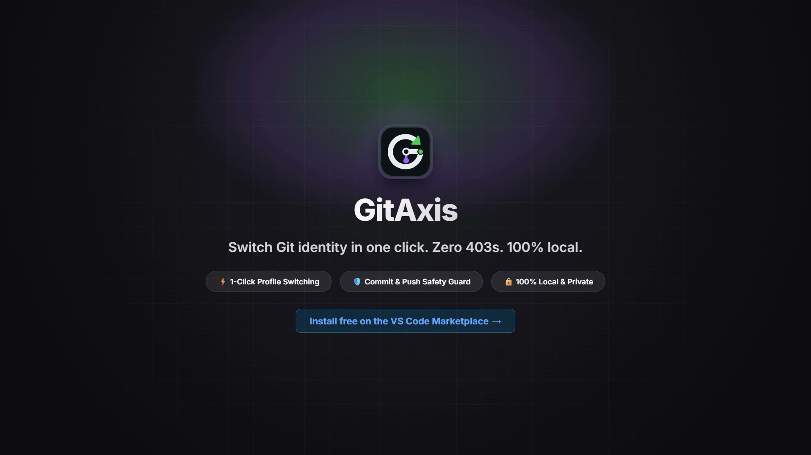

  <picture>
    <source media="(prefers-color-scheme: dark)" srcset="media/lockup-dark.svg">
    <source media="(prefers-color-scheme: light)" srcset="media/lockup-light.svg">
    
  </picture>

# GitAxis — Multi-Profile Git & GitHub Manager for VS Code

**GitAxis** is a dedicated multi-account control center for Visual Studio Code and VS Code Insiders. It gives you a clean, unified dashboard to organize, switch, and automate multiple Git and GitHub profiles (Work, Personal, Open Source, Client, Freelance) without terminal gymnastics or configuration drift.

---

## Demo

  <video src="media/demo.mp4" poster="media/demo-poster.jpg" controls="controls" muted="muted" width="100%">
    
  </video>

---

## Why GitAxis?

Modern developers frequently work across more than one GitHub account on the same machine. Managing them manually requires constant `.gitconfig` edits, juggling SSH keys, and dealing with credential conflicts.

GitAxis gives you a dedicated management layer right inside VS Code:

- **Centralized Profile Hub**: Store and organize all your GitHub accounts in one place with custom labels, author signatures, authentication methods, and SSH keys.
- **Context-Aware Switching**: Switch your entire Git environment (author name, email, remote URLs, and credential helper) per repository in a single click or with `Ctrl+Alt+G`.
- **Automated Directory Routing**: Define folder rules (e.g. `~/work/**` for Work, `~/personal/**` for Personal) so VS Code automatically activates the correct identity the moment you open a project.
- **Clean Identity Isolation**: Keep credentials, SSH keys, and tokens strictly isolated so each account operates independently without cross-contamination.

---

## Quick Start (30 Seconds)

1. **Open GitAxis**: Click the GitAxis icon in the Activity Bar or press `Ctrl+Alt+G` / `Alt+G` (`Cmd+Alt+G` on macOS).
2. **Add or Import Profiles**: Click **+ Add Profile** to configure author details, or click the search icon to scan and import existing machine accounts with 1 click.
3. **Switch & Code**: Click **[Switch]** on any profile. GitAxis updates the repository identity, aligns HTTPS remotes and credential helpers, and displays the active profile in the bottom status bar.

---

## Core Capabilities

- **Unified Account Management**: Maintain as many GitHub profiles as you need (Work, Personal, Open Source, Client, Bot) with independent author names, emails, and credentials.
- **Fast Profile Switching**: Switch identities on the fly via the sidebar, the dynamic status bar item, or the global `Ctrl+Alt+G` shortcut.
- **Automated Directory Routing ("Set-and-Forget")**: Map directories to profiles using Git's native `includeIf` mechanism, ensuring automatic identity assignment by folder structure.
- **Isolated Authentication & SSH**: Securely stores Personal Access Tokens in VS Code's hardware-backed `SecretStorage`. Injects `-o IdentitiesOnly=yes` into SSH commands so `ssh-agent` always presents the correct key.
- **Integrated Commit & Push Safety**: Built-in verification guards check author and remote ownership before committing or pushing, preventing accidental identity mismatches.
- **Seamless Native SCM Integration**: Integrates directly with VS Code's built-in Source Control. GitAxis prepares the identity and credential layer so native commit and push actions work seamlessly.

---

## Commands & Shortcuts

| Command | Shortcut | Description |
|---|---|---|
| `GitAxis: Switch Profile` | `Ctrl+Alt+G` or `Alt+G` (`Cmd+Alt+G`) | QuickPick to switch active profile |
| `GitAxis: Open Control Center` | — | Focus the GitAxis sidebar |
| `GitAxis: Show Effective Identity` | — | Inspect resolved Git author, SSH, and GCM config |
| `GitAxis: Configure Folder Rules` | — | Manage `includeIf` directory bindings |
| `GitAxis: Scan Existing Accounts` | — | Discover local Git and GitHub CLI logins |
| `GitAxis: Verify Profile Authentication` | — | Test profile GitHub credentials on demand |
| `GitAxis: Create Profile` | — | Open the form to add a new profile |
| `GitAxis: Manage Profiles` | — | List and edit existing profile configurations |
| `GitAxis: Remove All GitAxis Config` | — | Safe 1-click cleanup of all GitAxis include files |

---

## Configuration Settings

Configure via VS Code Settings (`Ctrl+,` / `Cmd+,`, search `GitAxis`):

| Setting | Default | Description |
|---|---|---|
| `gitaxis.guard.mode` | `"warn"` | Safety level (`"block"`, `"warn"`, `"off"`) for pre-commit and pre-push guards. |
| `gitaxis.confirmDestructiveOperations` | `true` | Confirmation for destructive Git commands (force push, rebase, hard reset). |
| `gitaxis.autoDetectProfile` | `true` | Auto-detect and prompt profile switch based on repository remote. |
| `gitaxis.promptScanOnFirstLaunch` | `true` | Prompt to scan local accounts on initial launch. |
| `gitaxis.advanced.allowGlobalScope` | `false` | Enable global scope option (modifies machine-wide `~/.gitconfig`). |

---

## Security & Privacy

- **100% Local Execution**: Runs entirely inside your local VS Code instance. Zero telemetry, zero analytics tracking, and no external servers.
- **OS-Encrypted Tokens**: Personal Access Tokens (PATs) are encrypted via VS Code's native `SecretStorage` API (Windows Credential Manager, macOS Keychain, Linux Secret Service).
- **Non-Destructive by Default**: Never touches machine-wide `~/.gitconfig` settings unless global scope is explicitly enabled.

---

## Installation

- **From VS Code**: Press `Ctrl+P` (or `Cmd+P`), run `ext install mshrinath.gitaxis`, and press Enter.
- **From Command Line**: `code --install-extension mshrinath.gitaxis`
- **From Marketplace**: [Visual Studio Marketplace](https://marketplace.visualstudio.com/items?itemName=mshrinath.gitaxis)

---

## License

This project is licensed under the [MIT License](LICENSE).
