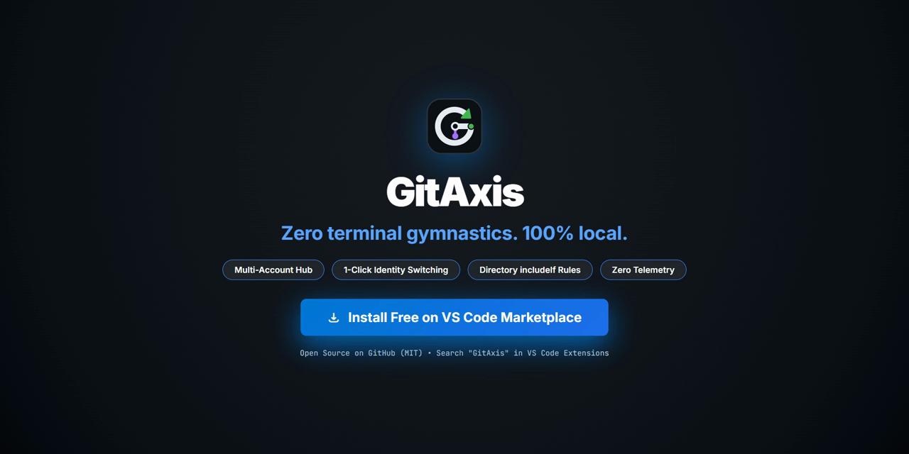

  

# GitAxis — Multi-Profile Git & GitHub Manager for VS Code

**GitAxis** is the dedicated multi-account control center for Visual Studio Code and VS Code Insiders. Seamlessly switch between work and personal GitHub accounts, manage multiple Git profiles, automate directory routing with Git's conditional includes (`includeIf`), and isolate SSH keys and credentials across repositories without terminal gymnastics, leaked tokens, or configuration drift.

---

## Demo

  

  <em><a href="https://github.com/MShrinath/GitAxis/raw/main/media/demo.mp4">Watch or Download Full Video with Audio (MP4)</a></em>

---

## Why GitAxis?

Modern developers frequently work across more than one GitHub account on the same machine. Managing them manually requires constant `.gitconfig` edits, juggling SSH keys, and dealing with credential conflicts.

GitAxis gives you a dedicated management layer right inside VS Code:

- **Centralized Profile Hub**: Store and organize all your GitHub accounts in one place with custom labels, author signatures, authentication methods, and SSH keys.
- **Context-Aware Switching**: Switch your entire Git environment (author name, email, remote URLs, and credential helper) per repository in a single click or with `Ctrl+Alt+G`.
- **Automated Directory Routing**: Define folder rules (e.g. `~/work/**` for Work, `~/personal/**` for Personal) so VS Code automatically activates the correct identity the moment you open a project.
- **Clean Identity Isolation**: Keep credentials, SSH keys, and tokens strictly isolated so each account operates independently without cross-contamination.

---

## Manual .gitconfig vs GitAxis

| Capability / Pain Point | Manual `.gitconfig` Configuration | GitAxis Profile Control Center |
|---|---|---|
| **Context-Aware Profile Switching** | Requires manual `git config user.name` and `user.email` commands or fragile aliases per repo. Easy to forget and misattribute commits. | 1-click profile switching from the Activity Bar, dynamic Status Bar indicator, or global hotkey (`Ctrl+Alt+G` / `Cmd+Alt+G`). Automatically updates repository identity and credential helpers. |
| **Automated Directory Routing (`includeIf`)** | Manually writing and debugging `[includeIf "gitdir:..."]` conditional blocks in `~/.gitconfig` with strict trailing-slash syntax that often breaks. | Automated "set-and-forget" directory rules mapped to profiles. Validates syntax, provides configuration previews, and sorts rules cleanly with non-destructive cleanup. |
| **Isolated SSH Keys & PAT Storage** | Default `ssh-agent` offers every loaded key until rejected; PAT tokens frequently end up hardcoded in plaintext `.git/config` or global configs. | Hardware-backed OS Keychain storage (`SecretStorage` on Windows Credential Manager, macOS Keychain, Linux Secret Service). Injects `-o IdentitiesOnly=yes` to isolate SSH keys per profile. |
| **Commit & Push Safety Guards** | No built-in safety net. Committing with a corporate email to a personal repository (or vice-versa) requires messy interactive rebases or force-pushes. | Built-in pre-commit and pre-push verification guards (`block`, `warn`, or `off`). Detects author email, profile identity, and remote ownership mismatches before changes leave your machine. |
| **Native VS Code SCM Integration** | Disconnected from the editor UI; VS Code defaults to global git settings without real-time identity feedback or active profile visibility. | Direct integration with VS Code's native Source Control view and Status Bar. Displays the active identity card, repo status, and verification badges right where you code. |

---

## Quick Start (30 Seconds)

1. **Open GitAxis**: Click the GitAxis icon in the Activity Bar or press `Ctrl+Alt+G` / `Alt+G` (`Cmd+Alt+G` on macOS).
2. **Add or Import Profiles**: Click **+ Add Profile** to configure author details, or click the search icon to scan and import existing machine accounts with 1 click.
3. **Switch & Code**: Click **[Switch]** on any profile. GitAxis updates the repository identity, aligns HTTPS remotes and credential helpers, and displays the active profile in the bottom status bar.

---

## Core Capabilities

- **Unified Account Management**: Maintain as many GitHub profiles as you need (Work, Personal, Open Source, Client, Bot) with independent author names, emails, and credentials.
- **Fast Profile Switching**: Switch identities on the fly via the sidebar, the dynamic status bar item, or the global `Ctrl+Alt+G` shortcut.
- **Automated Directory Routing ("Set-and-Forget")**: Map directories to profiles using Git's native `includeIf` mechanism, ensuring automatic identity assignment by folder structure.
- **Isolated Authentication & SSH**: Securely stores Personal Access Tokens in VS Code's hardware-backed `SecretStorage`. Injects `-o IdentitiesOnly=yes` into SSH commands so `ssh-agent` always presents the correct key.
- **Integrated Commit & Push Safety**: Built-in verification guards check author and remote ownership before committing or pushing, preventing accidental identity mismatches.
- **Seamless Native SCM Integration**: Integrates directly with VS Code's built-in Source Control. GitAxis prepares the identity and credential layer so native commit and push actions work seamlessly.

---

## Commands & Shortcuts

| Command | Shortcut | Description |
|---|---|---|
| `GitAxis: Switch Profile` | `Ctrl+Alt+G` or `Alt+G` (`Cmd+Alt+G`) | QuickPick to switch active profile |
| `GitAxis: Open Control Center` | — | Focus the GitAxis sidebar |
| `GitAxis: Show Effective Identity` | — | Inspect resolved Git author, SSH, and GCM config |
| `GitAxis: Configure Folder Rules` | — | Manage `includeIf` directory bindings |
| `GitAxis: Scan Existing Accounts` | — | Discover local Git and GitHub CLI logins |
| `GitAxis: Verify Profile Authentication` | — | Test profile GitHub credentials on demand |
| `GitAxis: Create Profile` | — | Open the form to add a new profile |
| `GitAxis: Manage Profiles` | — | List and edit existing profile configurations |
| `GitAxis: Remove All GitAxis Config` | — | Safe 1-click cleanup of all GitAxis include files |

---

## Configuration Settings

Configure via VS Code Settings (`Ctrl+,` / `Cmd+,`, search `GitAxis`):

| Setting | Default | Description |
|---|---|---|
| `gitaxis.guard.mode` | `"warn"` | Safety level (`"block"`, `"warn"`, `"off"`) for pre-commit and pre-push guards. |
| `gitaxis.confirmDestructiveOperations` | `true` | Confirmation for destructive Git commands (force push, rebase, hard reset). |
| `gitaxis.autoDetectProfile` | `true` | Auto-detect and prompt profile switch based on repository remote. |
| `gitaxis.promptScanOnFirstLaunch` | `true` | Prompt to scan local accounts on initial launch. |
| `gitaxis.advanced.allowGlobalScope` | `false` | Enable global scope option (modifies machine-wide `~/.gitconfig`). |

---

## Frequently Asked Questions (FAQ)

### How do I separate Work and Personal GitHub accounts?
GitAxis lets you define independent profiles (for example, **Work** with your corporate email, work SSH key, and enterprise credentials, and **Personal** with your personal email and personal SSH key). You can switch between profiles on demand with 1 click in the sidebar/status bar or via `Ctrl+Alt+G`. For hands-free workflow, use **Automated Directory Routing** to map folders (e.g. `~/work/**` to Work and `~/personal/**` to Personal); GitAxis automatically applies the matching profile the moment you open any repo in those directories.

### Does GitAxis work with SSH keys and commit signing?
Yes. GitAxis provides first-class support for isolated SSH keys and plays cleanly with existing signing setups:
- **SSH Keys**: Assign specific private keys per profile. GitAxis configures `core.sshCommand` with `-o IdentitiesOnly=yes` to guarantee `ssh-agent` only presents the specified key, eliminating SSH permission denied errors and identity cross-talk.
- **Commit Signing & GPG**: GitAxis operates non-destructively, preserving your machine's existing `user.signingKey`, `commit.gpgSign`, and SSH/GPG commit signing configurations without overriding or conflicting with them.

### How does GitAxis store credentials and Personal Access Tokens?
GitAxis uses VS Code's native `SecretStorage` API, delegating secret encryption directly to your operating system's credential store:
- **Windows**: Windows Credential Manager (DPAPI)
- **macOS**: Apple Keychain Services
- **Linux**: Secret Service API / libsecret

Tokens are never saved in plaintext files or repository configs, never logged, and never transmitted to external telemetry servers.

### Can I use GitAxis with GitHub Enterprise Server or custom remotes?
Yes. GitAxis supports both public `github.com` and custom **GitHub Enterprise Server (GHES)** hosts (e.g., `github.internal.corp`). Profiles can be configured with enterprise API domains, and directory routing supports both workspace paths (`gitdir:`) and remote URL conditions (`hasconfig:remote.*.url:`).

### Does GitAxis interfere with VS Code's built-in Git extension?
No. GitAxis is built to integrate natively alongside VS Code's built-in Git and Source Control (SCM) provider. GitAxis manages the Git configuration and credential layer (`.git/config`, `includeIf`, author metadata, and credential helper arguments). When you stage, commit, push, or sync branches using VS Code's standard UI or terminal, Git seamlessly operates under the active profile's configured identity.

---

## Security & Privacy

- **100% Local Execution**: Runs entirely inside your local VS Code instance. Zero telemetry, zero analytics tracking, and no external servers.
- **OS-Encrypted Tokens**: Personal Access Tokens (PATs) are encrypted via VS Code's native `SecretStorage` API (Windows Credential Manager, macOS Keychain, Linux Secret Service).
- **Non-Destructive by Default**: Never touches machine-wide `~/.gitconfig` settings unless global scope is explicitly enabled.

---

## Installation

- **From VS Code**: Press `Ctrl+P` (or `Cmd+P`), run `ext install mshrinath.gitaxis`, and press Enter.
- **From Command Line**: `code --install-extension mshrinath.gitaxis`
- **From Marketplace**: [Visual Studio Marketplace](https://marketplace.visualstudio.com/items?itemName=mshrinath.gitaxis)

---

## License

This project is licensed under the [MIT License](LICENSE).
